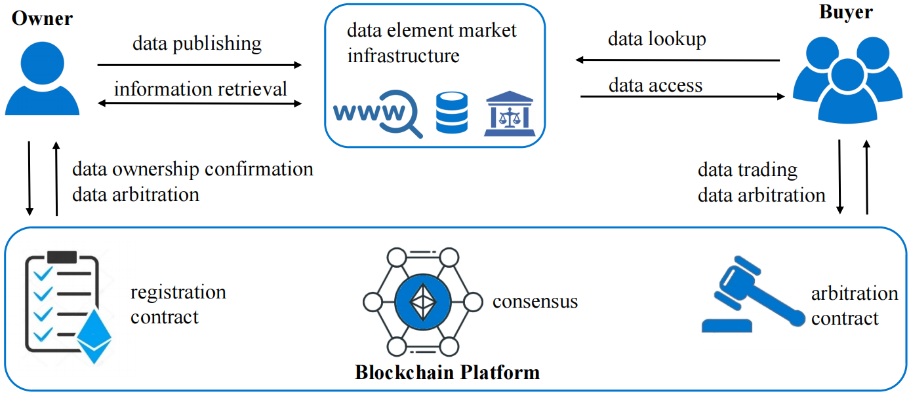

# Scalable and Dynamic Data Ownership Confirmation

Data ownership confirmation is a prerequisite for trustworthy data circulation.
Existing blockchain-based schemes often register each data item independently,
which leads to linear on-chain storage cost and poor support for dynamic updates.
This project implements a scalable data ownership confirmation and arbitration
scheme for large, heterogeneous, and frequently updated datasets.

The core idea is to model ownership confirmation as an authenticated data
structure problem. A data owner commits to an entire dataset with one compact
root hash on chain, while membership proofs for individual data items are
generated off chain and verified by smart contracts when arbitration is needed.

This repository contains the experimental implementation used to evaluate the
proposed scheme.

## System Model

<figure>
  <p align="center">
    
  </p>
  <p align="center">Figure 1: System model</p>
</figure>

The system includes the following entities.

- Data owner: organizes a large dataset, builds the off-chain authenticated data
  structure, registers the dataset root on chain, and generates ownership proofs
  for disputed data items.
- Data elements market infrastructure: provides data publishing, data search,
  compliance review, and certificate/arbitration support.
- Blockchain and smart contracts: maintain the registered dataset root and
  verify submitted ownership proofs in a public and tamper-resistant manner.
- Data consumer and arbitration process: use the on-chain verification result as
  credible evidence in ownership disputes.

## What We Do

- We build a layered authenticated data structure for large heterogeneous
  datasets. Data items are first grouped by type, stored in hash tables, and then
  authenticated by Merkle subtrees.
- We aggregate all subtree roots into one top root, so the blockchain only needs
  to store a constant-size commitment for the whole dataset.
- We support dynamic insert, update, and delete operations by locally updating
  the affected hash table and Merkle subtree.
- We generate membership proofs for individual data items and provide Solidity
  contract source code for root registration and layered proof verification.
- We provide synthetic and preprocessed real-dataset benchmarks for evaluating
  construction time, proof generation time, verification time, update time, and
  storage overhead.

## Reproduce

Use Go 1.26.2 for the off-chain experiments. Dependency versions are pinned in `go.mod` and `go.sum`; the comparison module includes the IAVL/ICS23 Keccak adaptation and upstream licenses.

| Experiment | Entry point |
|---|---|
| HT-Merkle: dataset size, category count and real datasets | [evaluation/README.md](evaluation/README.md) |
| HT-Merkle, Merkle, IAVL, SMT and MPT comparison | [comparison/README.md](comparison/README.md) |
| Smart contract gas measurements | [REPRODUCIBILITY.md](REPRODUCIBILITY.md) |

Quick correctness check and synthetic smoke test, from the repository root:

```sh
cd comparison
go test ./...
mkdir -p bin results
go build -o bin/bench ./cmd/bench
python3 run_experiment.py --profile smoke
```

The guides specify dataset preparation, full experiment commands and plotting. Downloaded datasets, local environments, compiled binaries and generated measurements/figures are excluded from Git. The shared packages in the repository root are required by the experiment modules.

For the on-chain evaluation, use Node.js 20.x and run:

```sh
npm ci
npm run reproduce:table3
```
